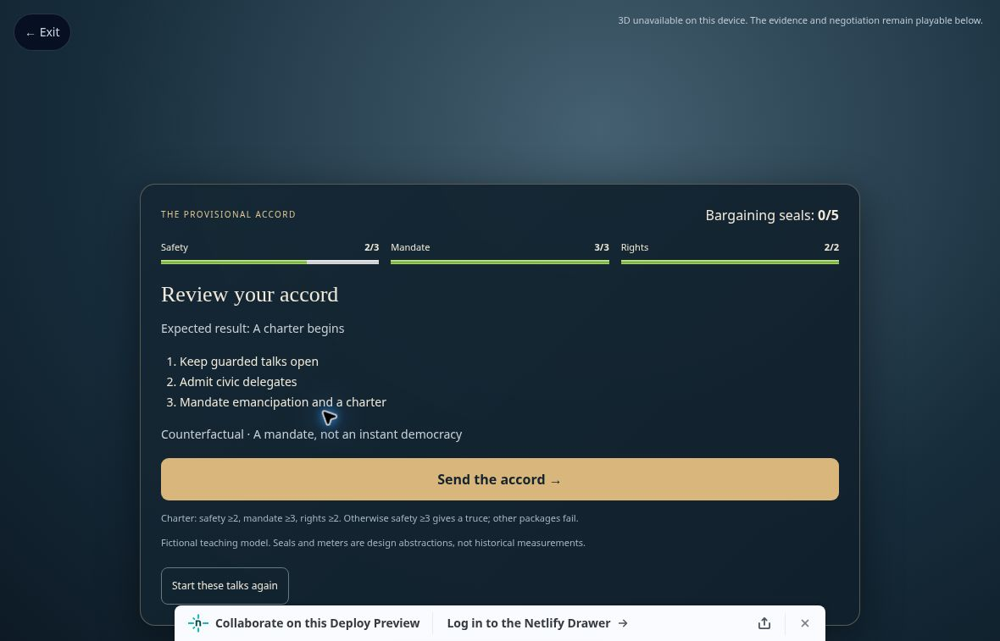

# The Winter Between Two Oaths

Draft chapter slice for `/experience/russian-empire`, independently based on main `a2826b89`. No Cold War files or unrelated translations changed.

## Design and scope

An invented courier explores a stylized St Petersburg on 26 December 1825 (14 December Old Style), then attempts a counterfactual mediation before the suppression of the Decembrist rising. Three evidence stations distinguish succession confusion, diverse reform programmes and opposing regiments. All three must be visited before entering talks.

The player negotiates three articles with five bargaining seals. Security, representation and an emancipation mandate compete for the same budget. Seven affordable packages lead to three endings: a precarious constitutional process, a temporary truce without a broad reform mandate, or a return to the historical suppression. The criteria and fictional nature of the model are visible before decisions; no arithmetic claims to predict historical causation. Endings do not link to the existing legacy timeline, whose instant-democracy premise contradicts this episode’s deliberately limited reform mandate. No battle, victory score or century-long deterministic promise is used.

New original procedural sets: snow-covered granite embankment, frozen river, civic wings, a distant Admiralty-inspired spire, a Bronze Horseman-inspired monument, standing formations, carriage, lamps and a document station; a cutaway mediation room with period furniture, papers, windows and candles. These are artistic composites, not surveyed reconstructions. The later Senate/Synod facade and completed St Isaac's Cathedral are deliberately omitted. All meshes are code-authored, with no downloaded or paid assets.

Geometry is merged by material into at most twelve batches per set. That count excludes the shared engine, snow particles and shadow/postprocessing passes; it is not a total draw-call or FPS measurement. Existing low-device DPR/postprocessing tier is retained.

## Interaction and languages

English, Uzbek and Korean are complete in typed chapter copy and the existing localized-script pipeline. Every landmark has a native DOM button. Lore dismisses with a close button or Escape and restores keyboard focus. Negotiation panels scroll at short viewport heights and reset to the top on article changes. Controls are at least 44px where actionable; two proposal columns collapse to one on phones. Unaffordable proposals are disabled, stale article clicks are rejected by the pure model, and final submission is guarded against duplicate clicks. Resetting talks does not discard evidence visits.

The renderer has a chapter-only error boundary: if WebGL cannot start, an explicit translated notice appears while the DOM narrative and decisions remain mounted. This is a fallback, not a substitute claimed as a working 3D scene.

## Verification

CPU checks (not browser play-tests):
- `node scripts/test-russian-empire.cjs`: 1,034 assertions, all seven affordable packages × three languages × full/skip narration, all seven beats and three endings. Actual model/store/localizer used. Checks budgets, stale clicks, reset, hotspot deduplication and nonempty translation coverage.
- `node scripts/test-russian-geometry.mjs`: all merged mesh attributes finite, nonempty bounds, bounded batch counts. Does not check rendered appearance or occlusion.
- `npx tsc --noEmit` and focused ESLint on touched application files.
- `npm run build` (large bundle warning remains).
- Repository-wide lint still reports the unchanged unused eslint-disable in `src/experience/world/greatwar.tsx:5`.

**Unverified:** real browser path play-throughs, responsive screenshots, keyboard/focus behavior in a browser, actual mobile touches, GPU scene rendering, camera occlusion and performance. The cloud browser has no usable WebGL context, and cannot reach this executor's loopback dev server; local headless browser attempts in sibling chapter work failed before page load due to environment restrictions. No 3D or mobile validation is inferred from source tests. No screenshot is attached because none of this new chapter has been truthfully captured in a browser yet.

Before visual signoff, open the deploy preview on a GPU-capable device. Complete all seven packages in English, Uzbek and Korean; check title, skip, each evidence card, Escape/focus return, unavailable offers, review/reset, all three endings and replay. Test 390×844, 360×640 and 844×390, large text, orbit/pinch, camera transitions and exit/re-entry. Simulate renderer failure separately and verify the notice and full DOM journey. Existing engine language changes restart the run; this chapter does not add persistence.

## Historical sources and interpretation

Read during implementation; all narrative is paraphrased, with no invented quotation attributed to a historical person.

- [State Archive of the Russian Federation: The Decembrist uprising](https://statearchive.ru/history/09.html). Archival documents anchor Constantine's renunciation, the succession crisis, reform projects, suppression and trials. The negotiation, courier and seals are expressly fictional.
- [State Historical Museum: Decembrist uprising painting](https://nav.shm.ru/en/exhibits/1427/). The museum describes Ladurner's 1852 painting and Nicholas I's retrospective sketch. It is treated as a later ruler-centred representation, not a neutral contemporary photograph.
- [Encyclopedia of St Petersburg: Decembrist uprising](https://www.encspb.ru/object/2855721519?dv=2856785120&lc=en). Used for square context and the failed persuasion/artillery sequence. Disputed casualty numbers are intentionally omitted.

The fictional reform mandate is not universal suffrage or immediate abolition by one signature. The alternate endings explicitly retain implementation, land and consent problems. The historical ending does not suggest the player's simplified meter caused the real suppression.

## Deploy-preview browser check

PR #13 preview built successfully. Real desktop-browser checks completed all seven affordable packages in Korean (three truce, one charter, three historical-return endings), plus charter runs in English and Uzbek. Evidence prerequisites, three reports, Escape/focus return, an unaffordable offer, talk reset, accord review and replay worked. Cinematics were skipped in these browser runs. This was DOM-only with no rendered 3D: console confirmed WebGL creation failure. It also exposed that a React error boundary alone did not catch the asynchronous renderer initialization, so a WebGL2 preflight was added before mounting Canvas. The updated preview visibly confirms the translated fallback in all three languages. Full narration/browser language-path matrix, mobile and GPU acceptance remain pending.

A static responsive test harness is available at `/qa/russian-empire-mobile.html`. It embeds the real app at 390×844, 360×640 or 844×390. This tests CSS/DOM viewport behavior, not physical touch, a device browser or GPU quality.
