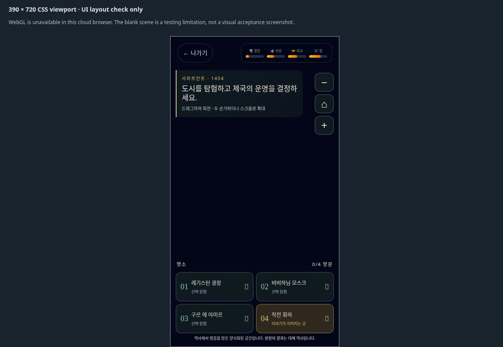
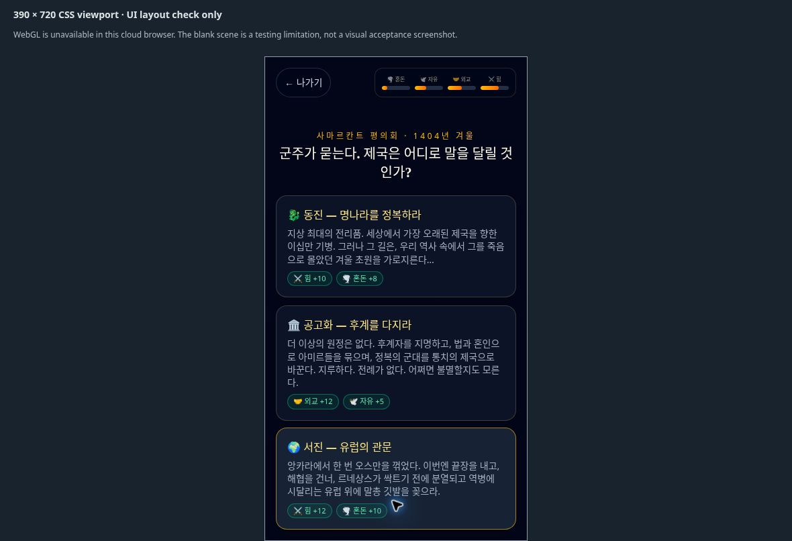
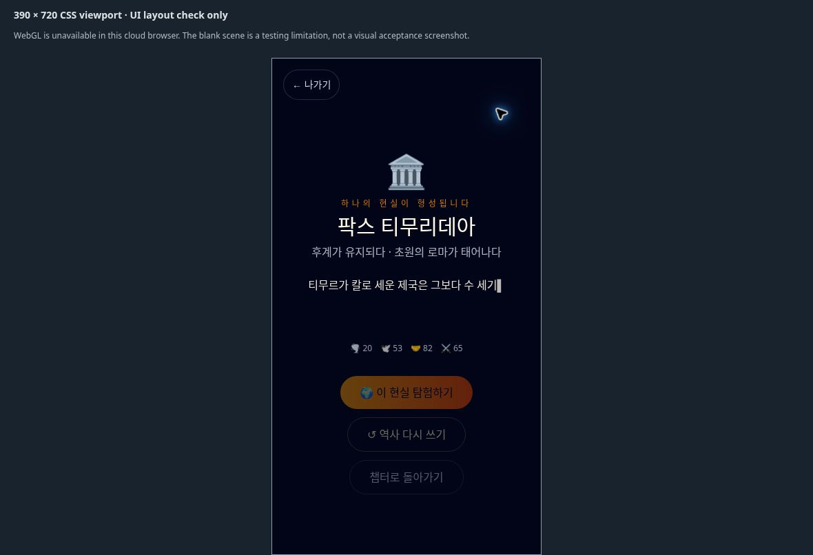

# Timur's Legacy: playable-polish QA

This change improves the existing Timur episode only. No new chapter, purchased asset, external texture, translation-file replacement, or Cold War change is included.

## Changes

- Samarkand: batched architectural details, tiled rills and animated water sheen, cypress planters, benches, merchant awnings/carpets/pottery, and warm dusk lanterns. Static additions use ten material batches and one animated water mesh; no extra lights.
- Accessible landmark dock with an explicit story destination and visit count. Keyboard-accessible alternatives to small 3D targets, close/Escape returns focus, and EN/UZ/KO UI copy.
- Authored landmark camera framing, zoom/reset buttons, gentler small-screen orbit speed. Camera commands do not reload beats or erase discoveries. Timur cinematic shot timing no longer reuses the total elapsed time as the next shot's local time.
- Chapter-scoped mobile layout: separated HUD/objective, 44px camera/close targets, scrollable decision/tactical/ending panels, safe-area spacing, and prevention of background page scrolling.

## Verified

- `npx tsc --noEmit`: passed.
- `npm run build`: passed (existing large-bundle warning remains).
- Focused ESLint on all changed TypeScript/TSX files: passed.
- `node scripts/test-timur.cjs`: 114 assertions passed, including graph integrity/reachability for all 20 beats, landmark framing data, discovery idempotence, camera command isolation, replay reset, peaceful ending, and east/west victory and defeat **outcome wiring**. Outcomes are injected at the store boundary; these checks do not exercise real-time combat.
- Browser UI at desktop size: landmark open, repeated visit, close, Escape, restored focus, council entry.
- Browser UI at a 390×720 CSS iframe viewport: landmark/council controls, all three council options visible, peaceful succession choices, skip narration, Pax Timuridea ending, replay returning to title. This is a responsive layout check, not physical touch-device testing.

## Blocked / not verified

The supplied cloud browser cannot create a WebGL context (also on the unchanged production experience). A separate software-rendered Chromium attempt did not produce a scene. Therefore the screenshots below deliberately show an empty background and are **UI evidence only**, not a claim that 3D visuals were accepted.

Still required before this draft is merge-ready:
- Inspect daytime/dusk Samarkand and all authored camera close-ups on a WebGL-capable browser.
- Check orbit/pinch/zoom/reset and camera interruption on a real mobile device, including landscape.
- Play east/west/revolt combat to completion, check tactical overlays and actual outcome balance.
- Measure frame rate, GPU memory, and camera clearance/occlusion on a low-tier phone.

`npm run lint` fails on a pre-existing unused `eslint-disable` directive in `src/experience/world/greatwar.tsx:5`. That unrelated file is intentionally unchanged.

## Truthful UI captures

The header in each screenshot identifies the viewport and WebGL limitation.

